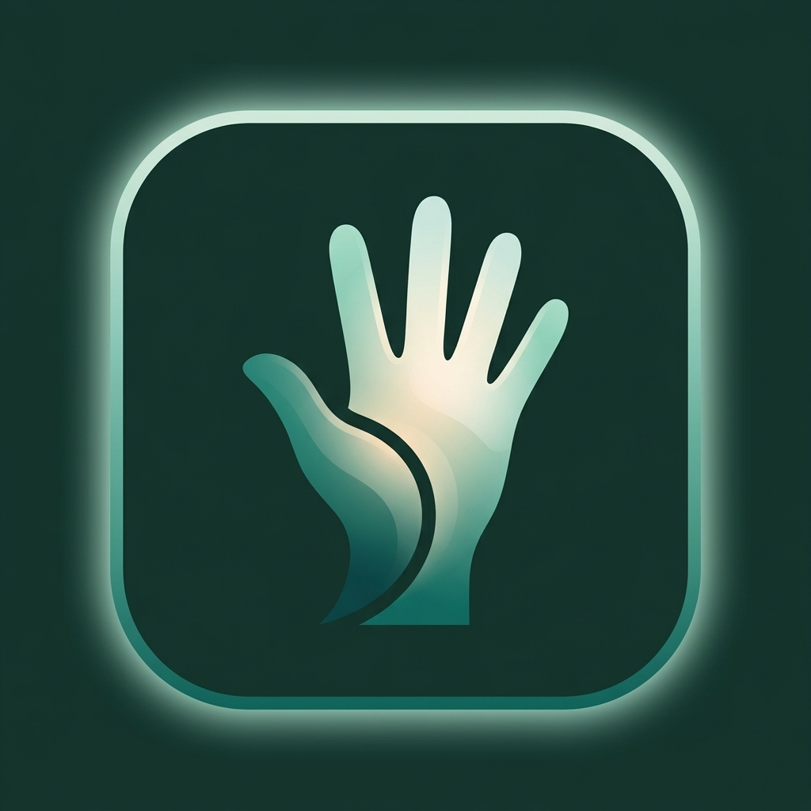
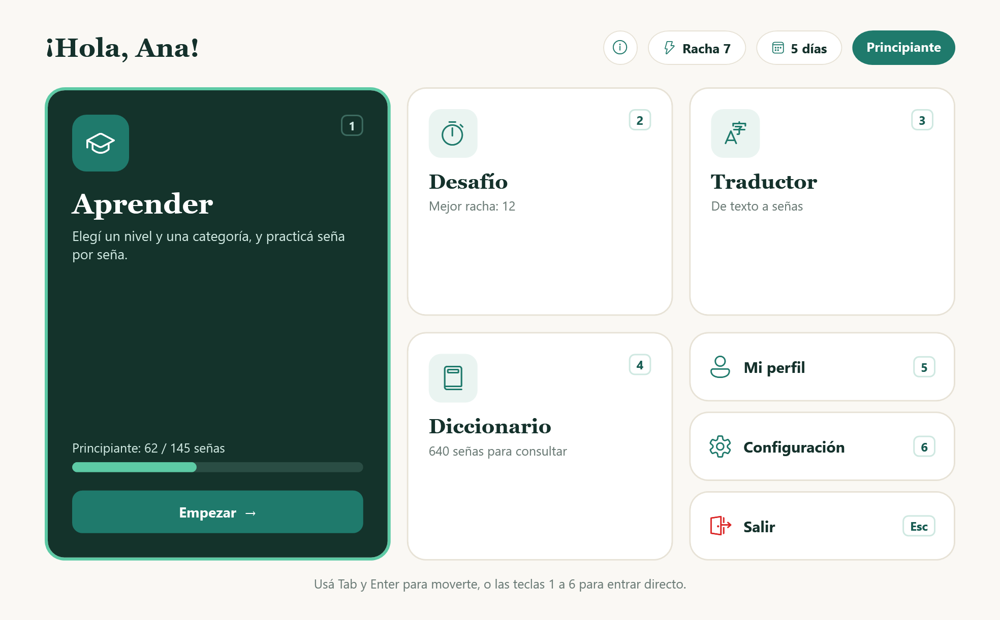
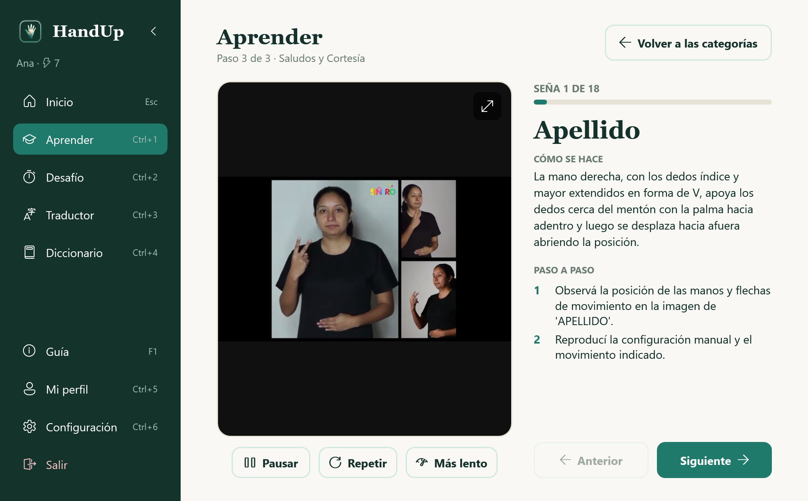
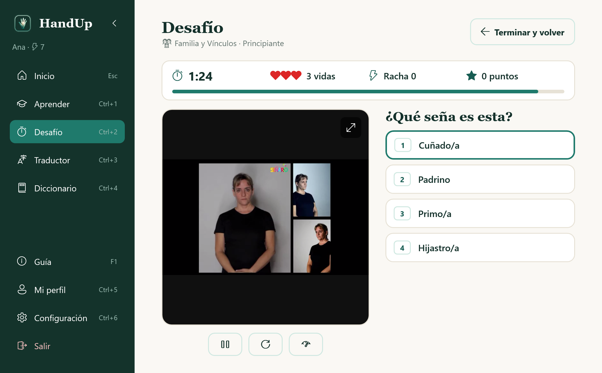
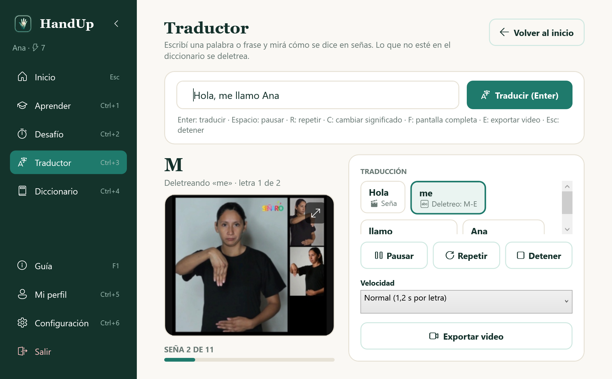
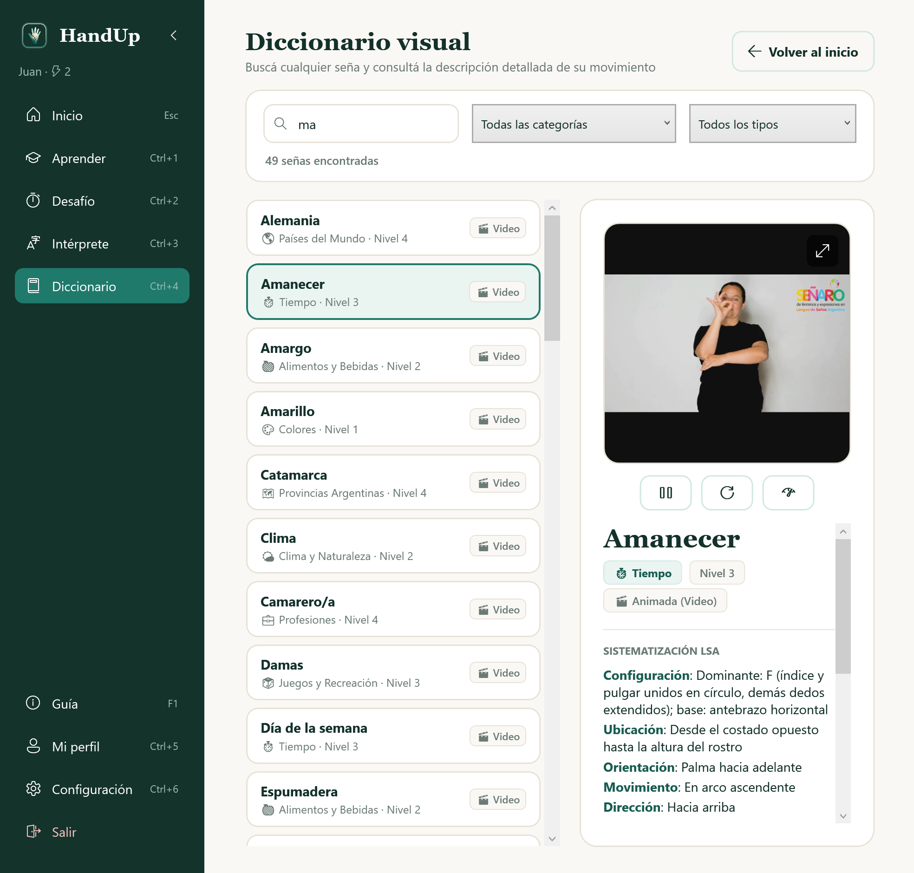

<p align="center">
  
</p>

<h1 align="center">HandUp</h1>

<p align="center">
  <strong>Una app de escritorio para aprender Lengua de Señas Argentina (LSA) a tu ritmo.</strong><br>
  640 señas en video · 24 categorías · 4 niveles · 100% usable con el teclado · sin internet
</p>

<p align="center">
  
</p>

---

## ¿Qué es HandUp?

HandUp enseña LSA paso a paso, como un curso que cada persona hace por su cuenta: mirás las señas, practicás, rendís una prueba y desbloqueás el nivel siguiente. Al aprobar el examen final obtenés un certificado.

Cada seña tiene su video, su **sistematización en LSA** (configuración, ubicación, orientación, movimiento y dirección) y una descripción en texto de cómo se mueven las manos, así que no depende del audio.

Es el proyecto final de la materia **Programación Genérica y Eventos (PGE)**.

## Qué se puede hacer

| | |
|---|---|
| **Aprender** | Elegís un nivel y una categoría (Saludos, Familia, Alimentos…), recorrés las señas de a una y después practicás con preguntas de opción múltiple o escribiendo la palabra. |
| **Prueba final** | Cada nivel termina con una prueba de palabras y frases en señas. Con 80% o más se desbloquea el siguiente. La de Avanzado es el examen final y entrega un certificado en PDF o PNG. |
| **Desafío** | Partida contrarreloj de 90 segundos con 3 vidas, puntaje y racha. Las señas que más fallás aparecen más seguido (repetición espaciada). |
| **Intérprete** | Escribís una palabra o una frase y la ves en señas. Lo que no está en el banco (por ejemplo, un nombre) se deletrea letra por letra. La interpretación se puede exportar como video MP4. |
| **Diccionario** | Buscador de las 640 señas que filtra mientras escribís, por tipo y por categoría. |
| **Mi perfil** | Progreso, estadísticas por categoría, rachas de aciertos y de días, y el certificado. |
| **Configuración** | Alto contraste, tres tamaños de texto y atajos de teclado a elección. |

Dentro de la app, el botón **"i"** o la tecla **F1** abre una guía de uso con capturas. La misma guía está en PDF: [`Presentacion/HandUp - Guia de uso.pdf`](Presentacion/HandUp%20-%20Guia%20de%20uso.pdf).

<p align="center">
  
  
</p>
<p align="center">
  
  
</p>

### Accesibilidad

- Todo se puede hacer con el teclado: las secciones tienen atajos (1 a 6, Ctrl+1 a 6), las respuestas se eligen con 1 a 4 y Esc vuelve un paso.
- Funciona con el Narrador de Windows.
- Modo de alto contraste y texto grande o muy grande, guardados por perfil.
- No hace falta escuchar nada: los videos no tienen audio necesario y cada seña tiene su descripción escrita.

## Cómo probarla

### Opción 1: la versión lista para usar

Con doble clic en [`Presentacion/publicar.bat`](Presentacion/publicar.bat) se arma `Entrega/HandUp.zip`: una carpeta con **"Abrir HandUp.exe"**, que trae .NET adentro, así que la persona que la recibe no tiene que instalar nada. Para armarla hace falta el [SDK de .NET 8](https://dotnet.microsoft.com/download/dotnet/8.0).

### Opción 2: desde el código

Requisitos: Windows 10 (versión 2004 o más nueva) u 11, y el [SDK de .NET 8](https://dotnet.microsoft.com/download/dotnet/8.0).

```bash
dotnet run --project ProyectoFinal/ProyectoFinal.csproj
```

También se puede abrir `ProyectoFinal/ProyectoFinal.sln` con Visual Studio 2022 y ejecutar con F5.

### Perfiles para probar

La app crea estos perfiles la primera vez que se abre. Todos tienen la contraseña `1234`:

| Usuario | Para qué sirve |
|---|---|
| `prueba` | Tiene todos los niveles desbloqueados: sirve para recorrer toda la app. Le falta rendir el examen final. |
| `nuevo` | Ana, que recién empieza en Principiante. |
| `avanzado` | Tomás, que ya llegó a Avanzado y tiene estadísticas y rachas. |

También se puede crear un perfil nuevo con **"Creala acá"**, en la pantalla de inicio de sesión.

## El contenido

- **640 señas** en **24 categorías**, ordenadas en 4 niveles: Principiante (145), Básico (211), Intermedio (174) y Avanzado (110).
- El abecedario y los números se muestran como imagen; el resto, como video.
- **1933 frases** armadas a partir de 96 plantillas, para las pruebas finales. Cada frase se valida contra el banco de señas al cargarse.

## Cómo está hecha

**C# con WPF sobre .NET 8.** Los datos se guardan en una base SQLite local (`handup.db`, que se crea sola junto al ejecutable). El banco de señas está en [`signs_database.json`](ProyectoFinal/signs_database.json) y se importa a la base al arrancar. No usa servicios externos ni necesita internet.

Cómo se aplican los temas de la materia:

| Tema | Dónde |
|---|---|
| **Programación genérica** | `IRepositorio<T>` (perfiles, señas y categorías), `HistorialNavegacion<T>` (la pila del botón Volver), `IndiceDeBusqueda<T>` (buscador del Intérprete), `ColaRepeticionEspaciada<T>` (Desafío) y `Database.Ejecutar<T>`. |
| **Polimorfismo** | `Sena` → `SenaEstatica` / `SenaAnimada`, cada una con su forma de `Reproducir()`. `Pregunta` → `PreguntaOpcionMultiple` (y su variante `PreguntaFrase`, para las frases) / `PreguntaTipeo`, cada una con su forma de `EvaluarRespuesta()`. |
| **Eventos** | `ProgresoActualizado`, `NivelDesbloqueado` y `HandUpCompletado` en `ServicioProgreso`, que escucha el menú. Las teclas de la práctica se despachan con una tabla de eventos (`Dictionary<Key, Func<bool>>`). |
| **Timers** | `DispatcherTimer` para la partida del Desafío y el deletreo del Intérprete. La barra del tiempo (`BarraTiempo`) es un control que se dibuja con `OnRender`. |
| **Excepciones** | Todas las propias heredan de `HandUpException` (`InvalidInputException`, `UserNotFoundException`, `BancoSenasException`, `MazoVacioException`…). Los errores inesperados se anotan en `errores.log` y la app avisa sin cerrarse. Si la base está corrupta, se aparta y se crea una nueva. |
| **GUI** | WPF con estilos propios, dos temas (normal y alto contraste), ventanas redimensionables y navegación completa con teclado. |

Las contraseñas se guardan con hash PBKDF2-SHA256 y sal, nunca en texto plano.

### Estructura del repositorio

```
ProyectoFinal/            Código de la app (solución, proyecto, ventanas y clases)
  Assets/                 Logo y banco multimedia de señas (imágenes y videos por categoría)
  Guia/                   Contenido de la guía de uso (guia.json) y sus capturas
  Temas/                  Tema normal y de alto contraste
  signs_database.json     Banco de señas
  frases.json             Plantillas de frases para las pruebas finales
Presentacion/
  HandUp - Guia de uso.pdf   Guía de uso en PDF
  generar-guia.ps1           Arma el PDF a partir de guia.json
  publicar.bat / .ps1        Arma Entrega/HandUp.zip, la versión lista para usar
```

## Fuentes del material

Los videos, las imágenes y las descripciones de las señas salen de diccionarios y videos de LSA hechos por docentes, intérpretes y la comunidad sorda. Cada seña guarda su fuente en el campo `source` de `signs_database.json`.

- **Señario, diccionario de LSA** (versiones 1 y 2): 399 señas. Es la base del banco.
- **LSA Database:** 164 señas. Parte de ellas son del dataset LSA64: Ronchetti, F., Quiroga, F., Estrebou, C., Lanzarini, L. y Rosete, A. (2016). *LSA64: An Argentinian Sign Language Dataset*. III-LIDI, Facultad de Informática, UNLP.
- **LSA Oficial (YouTube):** 40 señas.
- **Clips de YouTube** (37 señas), recortados y con el texto sobreimpreso tapado para usarlos en las preguntas:
  - Signs of Love: vocabulario de [los saludos](https://www.youtube.com/watch?v=_muAHDVEItk), [los verbos](https://www.youtube.com/watch?v=SHB1Rlg6uvM), [categorías de verbos](https://www.youtube.com/watch?v=1ICc2IZuy6A), [los lugares](https://www.youtube.com/watch?v=BD7h2yxvKwo), [el hogar](https://www.youtube.com/watch?v=WIV9V42FeQg) y [el transporte](https://www.youtube.com/watch?v=gPXlc7IaYYM).
  - Dirección de Documentación: [Pronombres en LSA](https://www.youtube.com/watch?v=iPKG67lXuoc) y [Verbos en LSA](https://www.youtube.com/watch?v=qo-uIEi3ko8).
  - Prof. Fabián Gervasoni: [preguntas y pronombres](https://www.youtube.com/watch?v=3dtU2H8X_lA) y [adverbios de cantidad](https://www.youtube.com/watch?v=xxZXycZMkyk).
  - [Adjetivos en LSA, parte I](https://www.youtube.com/watch?v=vBSQD1A3OIg).
  - ULSA: [listado de verbos en LSA](https://www.youtube.com/watch?v=1XW6tOX3Y1Y) y [preguntas en LSA](https://www.youtube.com/watch?v=W0M9GY_1EgI).
  - Maxi Villarruel: [lugares](https://www.youtube.com/watch?v=W18Q4ZqWBbo), [palabras varias 4](https://www.youtube.com/watch?v=9FbH1aIYMoc) y [palabras varias 9](https://www.youtube.com/watch?v=SJrDqJA5E_E).
  - LSA con Tere: [Adjetivos en LSA](https://www.youtube.com/watch?v=RH0ndn0_DMA).
  - Fundación Effata: [Medios de transporte en LSA](https://www.youtube.com/watch?v=IiJmufvvX-c).
  - Capacitación en LSA: [Clase 4, Familia](https://www.youtube.com/watch?v=feV-ra7rvPA).

La sistematización de cada seña se escribió a partir de su descripción. Las interpretaciones del Intérprete son aproximadas: HandUp es una herramienta para aprender y no reemplaza a un intérprete de LSA.

## Autores

- Avril Ogas
- Lorenzo Poletto

Proyecto final de Programación Genérica y Eventos (PGE).
